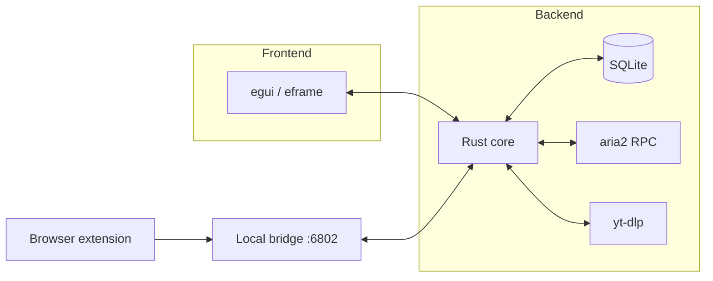

<div align="center">


# MoonHunt

**A fast, lightweight download manager for the desktop.**

Multi-connection downloads, torrents, and media - in a small native Rust app built with egui.

[](https://github.com/2sulraw/MoonHunt-DownloadManager/releases)
[](https://github.com/2sulraw/MoonHunt-DownloadManager/releases)
[](https://github.com/2sulraw/MoonHunt-DownloadManager/releases)
[](Cargo.toml)

[Features](#features) - [Install](#install) - [Extension](#browser-extension) - [Development](#development) - [Architecture](#architecture)

</div>

---

## Why MoonHunt

Most download managers are either a browser feature, an Electron app that eats a gigabyte,
or a command-line tool with a UI bolted on. MoonHunt is a native Rust/egui app that drives
**aria2** for throughput and **yt-dlp** for media, wrapped in a UI that stays out of the way.

It is small, it starts fast, and it keeps working while you do something else.

> **Early build:** MoonHunt is at `0.0.x`. Bugs happen - please
> [open an issue](https://github.com/2sulraw/MoonHunt-DownloadManager/issues) with what you
> were downloading and what went wrong.

> The previous Tauri/Vue implementation is archived at
> [MoonHunt-DownloadManager-archive](https://github.com/2sulraw/MoonHunt-DownloadManager-archive).

## Features

| Feature | What it does |
|---|---|
| **Multi-connection downloads** | Splits HTTP/FTP downloads across connections via aria2, with live speed, ETA, and per-file controls |
| **Torrents** | Add and manage `.torrent` downloads through the same queue |
| **Media downloads** | yt-dlp integration with format selection, JS-runtime solving, and optional FFmpeg merging |
| **Browser extension** | One-click handoff from Chrome/Firefox through a local bridge |
| **Scheduling** | Queue downloads for later with a built-in date/time picker |
| **Categories** | Group downloads and keep the queue organized |
| **Clipboard capture** | Detects copied links and offers to add them |
| **Hash verification** | Check finished files against a known hash |
| **Proxy support** | HTTP and SOCKS5 proxies with a live health check |
| **Addons** | Install community addons from a zip, folder, or URL |
| **Themes** | Polished dark and light modes, both contrast-tuned |
| **9 languages** | English, Farsi, French, Spanish, Portuguese, Russian, Japanese, Chinese, Arabic |
| **Low footprint** | Native Rust/egui shell, bundled aria2, SQLite history - no Electron, no WebView |
| **In-app updater** | Checks GitHub releases and installs the right package |

## Install

Grab the latest installer from **[Releases](https://github.com/2sulraw/MoonHunt-DownloadManager/releases)**.

Windows, `.deb`, and `.rpm` packages bundle aria2. Arch and the AppImage use the system
`aria2` package.

### Windows

- `.exe` (NSIS installer)

### Linux

Linux builds require glibc 2.35+ (Ubuntu 22.04 or newer).

- `.deb` for Debian / Ubuntu / Mint / Pop!_OS
- `.rpm` for Fedora / RHEL / openSUSE
- `.AppImage` for any distribution

### Arch Linux

Prebuilt package:

```bash
sudo pacman -U moonhunt-0.0.7-1-x86_64.pkg.tar.xz
```

From source: download `PKGBUILD`, `moonhunt.install`, and
`moonhunt-0.0.7-source.tar.gz` into one directory, then:

```bash
makepkg -si
```

This installs `moonhunt` to `/usr/bin`. Launch it from your app menu or run `moonhunt`.

### AppImage

```bash
chmod +x moonhunt_*.AppImage
./moonhunt_*.AppImage
```

If FUSE is unavailable, run it with `--appimage-extract-and-run`.

The in-app updater picks the correct package for your system on the next release.

## Browser extension

The companion extension lives at
**[MoonHunt-Extension](https://github.com/2sulraw/MoonHunt-Extension)**.

- **Firefox:** install from [Firefox Add-ons](https://addons.mozilla.org/en-US/firefox/addon/moonhunt-download-manager/)
- **Chromium:** load the unpacked build from the extension repo

It talks to MoonHunt over a local bridge, so links go straight into the queue.

## Development

### Prerequisites

- [Rust](https://www.rust-lang.org/tools/install) stable
- A C toolchain and the native libraries for your platform

**Windows:** no extra runtime is required; the release build uses the GUI subsystem.

**Linux** - install the development packages for your distro:

| Distro | Packages |
|---|---|
| Arch / Manjaro | `pkgconf openssl gtk3 libxkbcommon wayland libx11 libxi libxcursor libxrandr libxinerama mesa` |
| Debian / Ubuntu / Mint / Pop | `pkg-config libssl-dev libgtk-3-dev libxkbcommon-dev libwayland-dev libx11-dev libxi-dev libxcursor-dev libxrandr-dev libxinerama-dev libgl1-mesa-dev` |
| Fedora / RHEL / CentOS | `pkgconf openssl-devel gtk3-devel libxkbcommon-devel wayland-devel libX11-devel libXi-devel libXcursor-devel libXrandr-devel libXinerama-devel mesa-libGL-devel` |

### Run

```bash
cargo run -p moonhunt
```

### Test

```bash
cargo test --workspace
```

### Build

```bash
cargo build --release -p moonhunt
```

The binary lands in `target/release/moonhunt` (`moonhunt.exe` on Windows).

Packaging lives in:

- `packaging/windows/moonhunt.nsi` - NSIS installer
- `packaging/linux/package.sh` - `.deb`, `.rpm`, and AppImage
- `packaging/arch/PKGBUILD` - Arch package

Linux CI runs `cargo build --release -p moonhunt` on every push and pull request.

## Architecture



```
app/                  egui (eframe) frontend
crates/core/          aria2 RPC, yt-dlp, SQLite, extension bridge, updater
packaging/            Windows NSIS, Linux deb/rpm/AppImage, Arch
.github/workflows/    Linux CI
```

## License

MIT - see [`Cargo.toml`](Cargo.toml). The original Tauri/Vue app is GPL-3.0 and remains
available in the archive.
