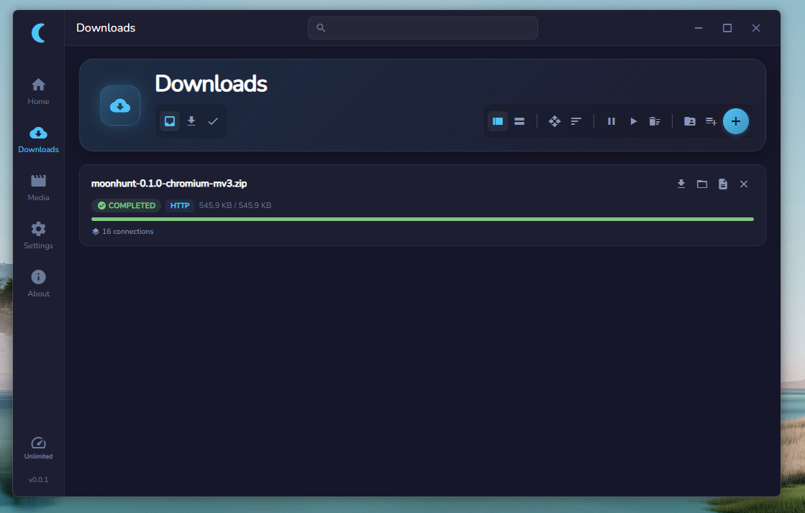

# MoonHunt


A desktop download manager built with [Tauri 2](https://v2.tauri.app/),
[Vue 3](https://vuejs.org/), and [aria2](https://aria2.github.io/).

MoonHunt runs your downloads through aria2 and handles media via
[yt-dlp](https://github.com/yt-dlp/yt-dlp).



> **Note — early build:** this app is in an early stage, so there may be bugs.
> If you encounter one, please [open an issue](https://github.com/2sulraw/MoonHunt-DownloadManager/issues)
> and report it.

## Features

- **Media downloads** — videos and audio via yt-dlp, with format selection,
  JS-runtime solving, and optional FFmpeg merging
- **Torrent support** — add and manage `.torrent` downloads via aria2
- **Proxy support** — HTTP and SOCKS5 proxies with a live health check
- **Performance** — low usage of memory, CPU, disk

## Install

Download the latest installer (Windows NSIS `.exe` or `.msi`) from the
[Releases](https://github.com/2sulraw/MoonHunt-DownloadManager/releases) page.
aria2 is bundled — no extra setup required.

## Browser Extension

A companion browser extension (Chromium + Firefox) is available at
[MoonHunt-Extension](https://github.com/2sulraw/MoonHunt-Extension).

**Firefox:** install directly from
[Firefox Add-ons (AMO)](https://addons.mozilla.org/en-US/firefox/addon/moonhunt-download-manager/).

The Chromium version is available from the extension repo above.

## Development

### Prerequisites

- [Node.js](https://nodejs.org/) 18+
- [Rust](https://www.rust-lang.org/tools/install) toolchain
- [Tauri prerequisites](https://v2.tauri.app/start/prerequisites/) — WebView2
  on Windows, webkit2gtk on Linux

### Run

```bash
npm install
npm run tauri dev
```

### Build

```bash
npm run tauri build
```

Output installers land in `src-tauri/target/release/bundle/`. The build bundles
`aria2c` as a Tauri sidecar from `src-tauri/binaries/`.

## Architecture

```
moonhunt/
├── src/                  # Vue 3 frontend
│   ├── components/       # reusable UI components
│   ├── composables/      # state + logic hooks
│   ├── layouts/          # app shell (sidebar, titlebar)
│   ├── router/           # Vue Router config
│   ├── types/            # TypeScript definitions
│   ├── utils/            # shared formatters/helpers
│   └── views/            # Home, Downloads, Media, Settings
├── src-tauri/            # Rust backend
│   └── src/
│       ├── aria2/        # aria2 RPC client + process lifecycle
│       ├── db/           # SQLite persistence
│       ├── extension/    # HTTP bridge for the browser extension
│       ├── ytdlp/        # yt-dlp integration
│       ├── update.rs     # GitHub-releases update check + installer
│       └── ...
└── public/               # static assets (tutorial gifs, changelog)
```

## License

Copyright © 2sulraw. All rights reserved.