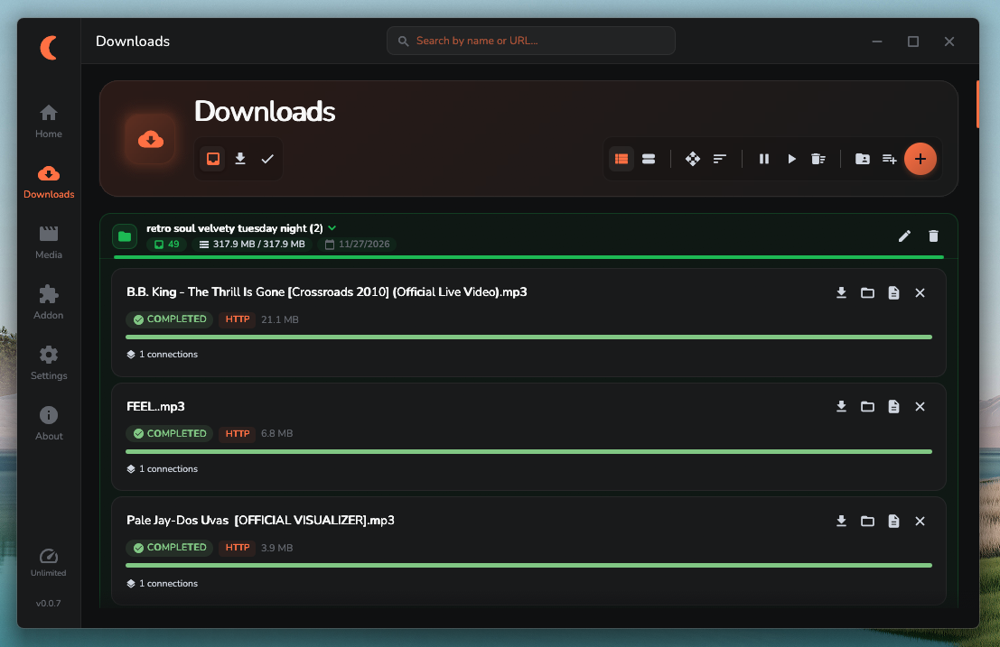
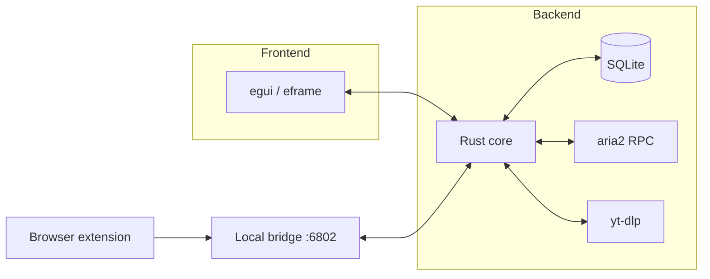

<div align="center">


# MoonHunt

**A fast, lightweight download manager for the desktop.**

Downloads, torrents, and media in one small native app.

Built in Rust with egui.

[](https://github.com/2sulraw/MoonHunt-DownloadManager/releases)
[](https://github.com/2sulraw/MoonHunt-DownloadManager/releases)
[](https://github.com/2sulraw/MoonHunt-DownloadManager/releases)
[](Cargo.toml)

</div>

---

**Jump to:** [Screenshot](#screenshot) - [Features](#features) - [Install](#install) - [Extension](#browser-extension) - [Development](#development) - [Architecture](#architecture)

---

## Screenshot



---

## What is MoonHunt?

MoonHunt is a download manager for your computer.

Most download managers fall into one of three groups:

- A feature buried in your browser.
- A big app that takes a gigabyte of memory.
- A command-line tool with a rough interface on top.

MoonHunt is different. It is a small native app.

It uses two proven tools behind the scenes:

- **aria2** for fast, multi-connection downloads.
- **yt-dlp** for video and audio.

The interface stays simple and out of your way.

It starts fast. It stays small. It keeps working while you do other things.

> **Early build:** MoonHunt is at `0.0.x`.
> Bugs can happen.
> If something goes wrong, [open an issue](https://github.com/2sulraw/MoonHunt-DownloadManager/issues).
> Tell us what you were downloading and what happened.

> The old Tauri/Vue version is archived at
> [MoonHunt-DownloadManager-archive](https://github.com/2sulraw/MoonHunt-DownloadManager-archive).

---

## Features

### Downloads

- **Multi-connection downloads.** Splits HTTP and FTP files across connections with aria2.
- **Live progress.** See speed, time left, and per-file controls.
- **Torrents.** Add and manage `.torrent` files in the same queue.
- **Scheduling.** Queue a download for a later date and time.
- **Categories.** Group your downloads and keep the queue tidy.
- **Clipboard capture.** Copies a link? MoonHunt offers to add it.
- **Hash check.** Check a finished file against a known hash.

### Media

- **Video and audio.** Download media with yt-dlp.
- **Format choice.** Pick the format you want.
- **FFmpeg merge.** Merge video and audio when you need to.

### App

- **Browser extension.** Send links from Chrome or Firefox in one click.
- **Proxy support.** Use HTTP or SOCKS5 proxies with a live health check.
- **Addons.** Install community addons from a zip file, a folder, or a URL.
- **Themes.** A dark mode and a light mode, both tuned for contrast.
- **9 languages.** English, Farsi, French, Spanish, Portuguese, Russian, Japanese, Chinese, and Arabic.
- **Low footprint.** Native Rust and egui. No Electron. No WebView. History in SQLite.
- **In-app updater.** Checks GitHub releases and installs the right package.

---

## Install

Get the latest installer from **[Releases](https://github.com/2sulraw/MoonHunt-DownloadManager/releases)**.

The Windows, `.deb`, and `.rpm` packages include aria2 for you.
Arch and the AppImage use the aria2 package on your system.

### Windows

- Download the `.exe` file. It is an NSIS installer.
- Run it.

### Linux

Linux builds need glibc 2.35 or newer. That means Ubuntu 22.04 or newer.

Pick the package for your system:

- `.deb` for Debian, Ubuntu, Mint, and Pop!_OS
- `.rpm` for Fedora, RHEL, and openSUSE
- `.AppImage` for any distribution

### Arch Linux

Prebuilt package:

```bash
sudo pacman -U moonhunt-0.0.7-1-x86_64.pkg.tar.xz
```

From source:

1. Download `PKGBUILD`, `moonhunt.install`, and `moonhunt-0.0.7-source.tar.gz` into one folder.
2. Run:

```bash
makepkg -si
```

This installs `moonhunt` to `/usr/bin`.
Open it from your app menu, or run `moonhunt` in a terminal.

### AppImage

```bash
chmod +x moonhunt_*.AppImage
./moonhunt_*.AppImage
```

If FUSE is not available, run it with `--appimage-extract-and-run`.

The in-app updater picks the right package for your system on the next release.

---

## Browser extension

The extension lives in its own repo:
**[MoonHunt-Extension](https://github.com/2sulraw/MoonHunt-Extension)**.

- **Firefox:** install from [Firefox Add-ons](https://addons.mozilla.org/en-US/firefox/addon/moonhunt-download-manager/).
- **Chromium:** load the unpacked build from the extension repo.

It talks to MoonHunt over a local bridge.
Links go straight into your queue.

---

## Development

### Prerequisites

- [Rust](https://www.rust-lang.org/tools/install) stable
- A C toolchain
- The native libraries for your platform

**Windows:** nothing else is needed.
The release build uses the GUI subsystem.

**Linux:** install the dev packages for your distro.

**Arch / Manjaro**

```text
pkgconf openssl gtk3 libxkbcommon wayland libx11 libxi libxcursor libxrandr libxinerama mesa
```

**Debian / Ubuntu / Mint / Pop!_OS**

```text
pkg-config libssl-dev libgtk-3-dev libxkbcommon-dev libwayland-dev libx11-dev libxi-dev libxcursor-dev libxrandr-dev libxinerama-dev libgl1-mesa-dev
```

**Fedora / RHEL / CentOS**

```text
pkgconf openssl-devel gtk3-devel libxkbcommon-devel wayland-devel libX11-devel libXi-devel libXcursor-devel libXrandr-devel libXinerama-devel mesa-libGL-devel
```

### Run

```bash
cargo run -p moonhunt
```

### Test

```bash
cargo test --workspace
```

### Build

```bash
cargo build --release -p moonhunt
```

The binary lands in `target/release/moonhunt`.
On Windows it is `moonhunt.exe`.

Linux CI runs `cargo build --release -p moonhunt` on every push and pull request.

### Packaging

- `packaging/windows/moonhunt.nsi` - NSIS installer
- `packaging/linux/package.sh` - `.deb`, `.rpm`, and AppImage
- `packaging/arch/PKGBUILD` - Arch package

---

## Architecture



### Folder layout

- `app/` - egui (eframe) frontend
- `crates/core/` - aria2 RPC, yt-dlp, SQLite, extension bridge, updater
- `packaging/` - Windows NSIS, Linux deb/rpm/AppImage, Arch
- `.github/workflows/` - Linux CI

---

## License

MIT. See [`Cargo.toml`](Cargo.toml).

The original Tauri/Vue app was GPL-3.0.
It is still available in the archive.
